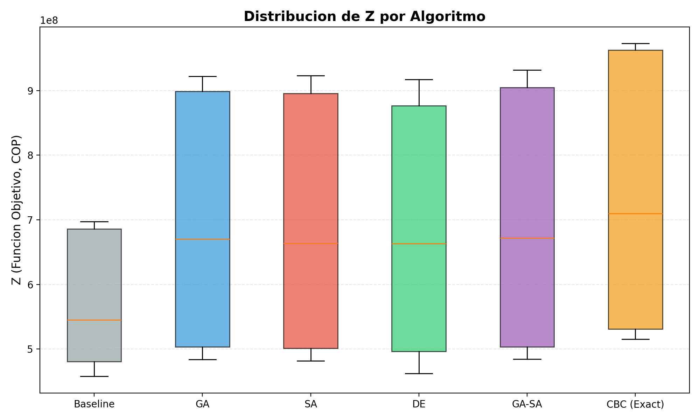
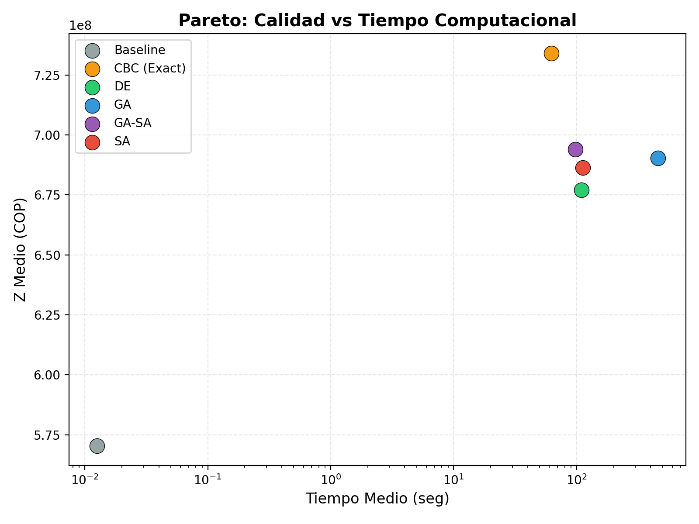
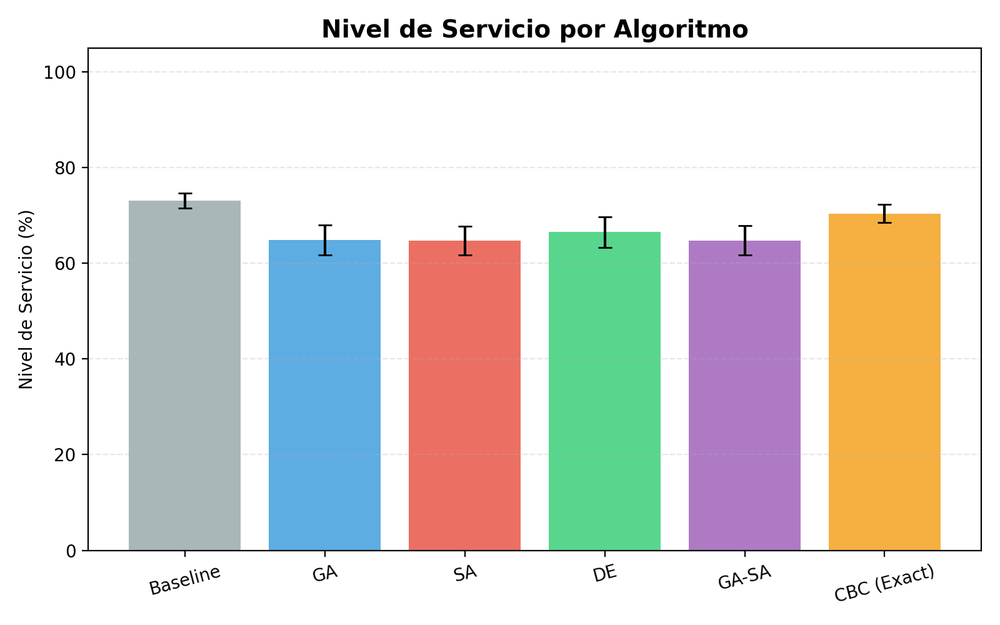

# Reporte de Resultados - Fase 4

## Tabla de Resultados Principal

| Algoritmo | Z Medio | Std | Gap (%) | Servicio (%) | Inv. Medio | Tiempo (s) | N |
|-----------|---------|-----|---------|-------------|-----------|------------|---|
| Baseline | 570,336,848 | 92,149,776 | 20.48 | 73.1 | 20,818.6 | 0.0 | 30 |
| GA | 690,423,342 | 166,668,329 | 5.81 | 64.8 | 15,268.5 | 457.8 | 180 |
| SA | 686,304,632 | 166,565,353 | 6.39 | 64.8 | 15,623.8 | 112.1 | 180 |
| DE | 677,110,773 | 164,104,011 | 7.64 | 66.5 | 16,413.5 | 109.7 | 180 |
| GA-SA | 694,024,020 | 169,327,252 | 5.37 | 64.8 | 14,773.7 | 97.6 | 180 |
| CBC (Exact) | 734,147,038 | 184,321,932 | 0.00 | 70.4 | 5,196.3 | 62.1 | 30 |

## Tabla de Hipotesis

| Hipotesis | Resultado | p-valor | Efecto | Veredicto |
|-----------|-----------|---------|--------|-----------|
| H1 (GA vs Baseline: mejora >= 5% (...) | 19.51% | 0.0000 | d=0.883 (large) | APROBADA |
| H1 (SA vs Baseline: mejora >= 5% (...) | 18.77% | 0.0000 | d=0.853 (large) | APROBADA |
| H1 (DE vs Baseline: mejora >= 5% (...) | 17.19% | 0.0000 | d=0.796 (medium) | APROBADA |
| H1 (GA_SA vs Baseline: mejora >= 5...) | 20.08% | 0.0000 | d=0.898 (large) | APROBADA |
| H2 (GA-SA vs best{GA,SA,DE}: gap <...) | -0.44% | 0.0000 | d=0.020 (negligible) | APROBADA |
| H2-run (GA-SA vs best{GA,SA,DE}: gap <...) | -0.06% | 0.0000 | d=0.003 (negligible) | APROBADA |
| H2-time (GA-SA time <= 50% CBC time (ra...) | 11730.92% | nan | d=0.000 (n/a) | RECHAZADA |
| H3 (GA vs Baseline: reduccion inve...) | 26.36% | 0.0000 | d=1.487 (large) | APROBADA |
| H3 (SA vs Baseline: reduccion inve...) | 24.60% | 0.0000 | d=1.388 (large) | APROBADA |
| H3 (DE vs Baseline: reduccion inve...) | 20.95% | 0.0000 | d=1.139 (large) | APROBADA |
| H3 (GA_SA vs Baseline: reduccion i...) | 28.80% | 0.0000 | d=1.626 (large) | APROBADA |
| H3-lowrot (GA vs Baseline: reduccion inve...) | nan% | nan | d=nan (n/a) | RECHAZADA |
| H3-lowrot (SA vs Baseline: reduccion inve...) | nan% | nan | d=nan (n/a) | RECHAZADA |
| H3-lowrot (DE vs Baseline: reduccion inve...) | nan% | nan | d=nan (n/a) | RECHAZADA |
| H3-lowrot (GA_SA vs Baseline: reduccion i...) | nan% | nan | d=nan (n/a) | RECHAZADA |

## Graficos

### Boxplot de Fitness por Algoritmo

### Pareto: Calidad vs Tiempo

### Nivel de Servicio

## Limitaciones

1. Instancias generadas sinteticamente (no datos reales de planta)
2. Time limit de 300s puede limitar convergencia en instancias Large
3. CBC no garantiza optimo en instancias Medium/Large dentro del time limit
4. Baseline simple (proporcional) puede no representar practica industrial real